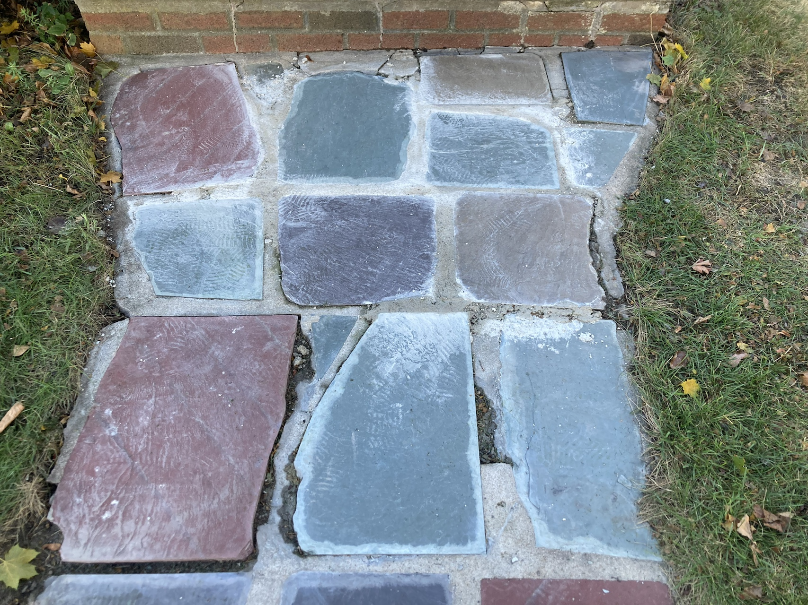
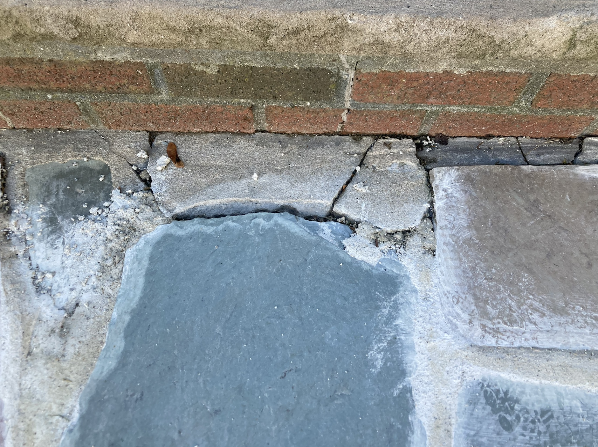
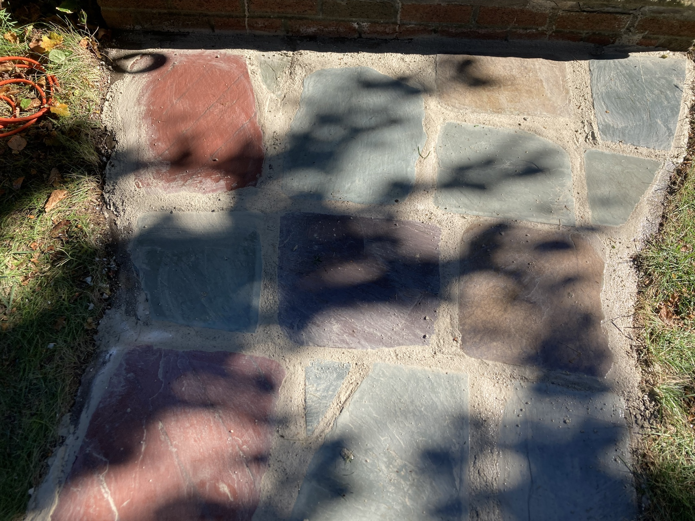
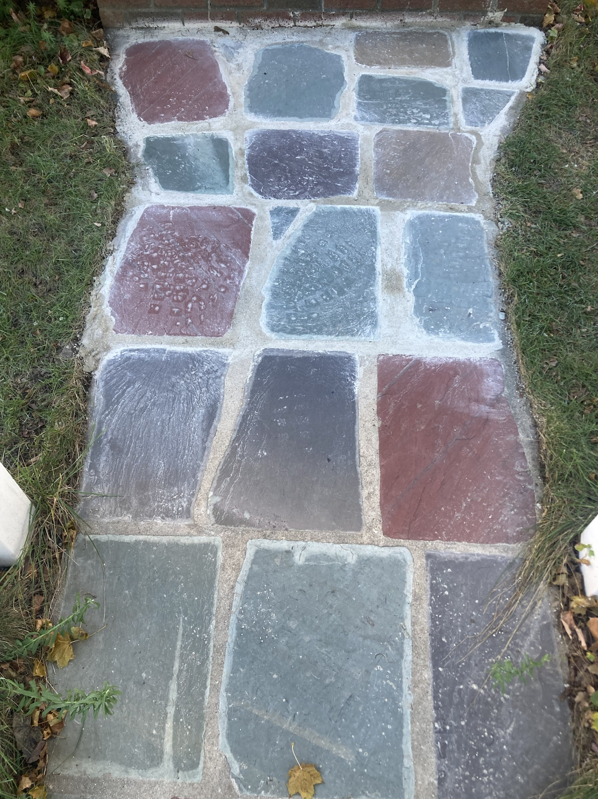

The old flagstone walkway is coming apart. 

The mortar has spalled. Grass, weeds and moss are growing in between the stones
and the stones have become a bit uneven. 

(I took photos after starting the fix. I've removed some of the weeds and moss
and soil from the cracks and applied mortar to the right edge of the left
top-most stone)

We don't have the time to do this properly so let's patch it over so we can kick
the can a few years down the road.

## Supplies and tools

1. Rapid set mortar (I might use slower setting mortar next time)
1. Two big buckets, one small bucket
1. Two measuring cups
1. Mixing paddle and drill
1. Angle grinder with masonry wheel
1. Wirebrush
1. Trowel
1. Large sponge
1. Hose

## First round

1. Used hands to remove moss and weeds, dirt and loose mortar
1. Used angle grinder to remove mortar where gap to stone would be too narrow
1. Wire brush to scrub and clean joints and roughen up surfaces

Then I made two mistakes

1. Mixed 4000 ml of mix (+1000ml of water).
1. Mixed by hand

This turned out to be too much. My arm got fatigued while mixing it and I lost
fine motor control when I was applying the mix.

The mixing took long enough and I couldn't apply it fast enough that about a
quarter hardened in the bucket and was wasted.

I used the sponge to clean off stones, it was not perfect and I was a bit timid
because I was worried about wiping off the mortar but it worked well enough.

## Second round

1. Mixed batches of 1000 ml mix and 250 ml water at a time
1. Used the M12 drill at low speed and full torque with the mixing paddle
1. For some of the batches I added a little excess water because I was getting
   annoyed by the stickiness of the strict 1:4 mix. We'll see how badly that
   affects the strength

It was a wonderful sunny New England fall day, the kind that makes the
six-months of winter bearable. The shadows of the trees make it a bit hard to
see but there is a bunch of mortar haze on the stones.

I got rid of the haze by misting the stones and then using a stiff bristled
brush to scrub the stones with some force.

I could have been more aggressive with the sponge perhaps, but the islands of
mortar on the stone face were weak enough that cleaning them off wasn't an
issue.

## Final state

It could do with another round of scrubbing off the mortar haze but I don't want
to waste water and will let one of the fall showers do the job.

## Lessons learned

1. I might try slower setting mortar next time if this application spalls
   quickly. 
1. Don't be shy with the sponge. 
1. The M12 FUEL drill is fine for this amount of mixing, though the drill got a
   bit dirty with all the splatter.

## New tools

1. Mixing paddle 
